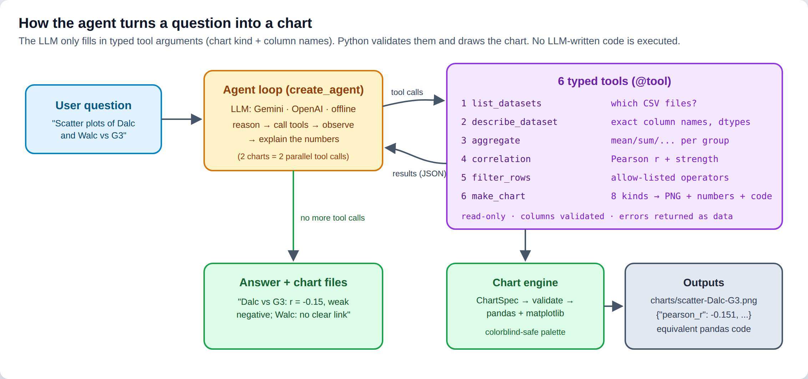
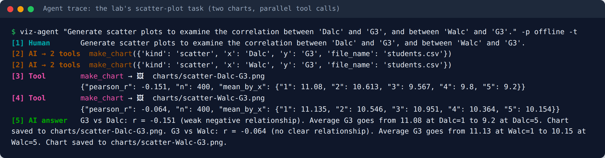
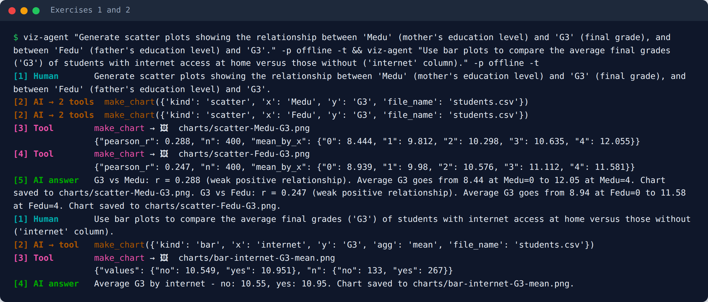
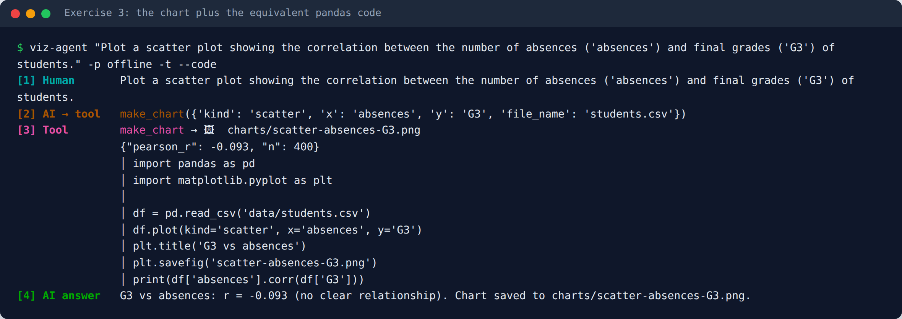
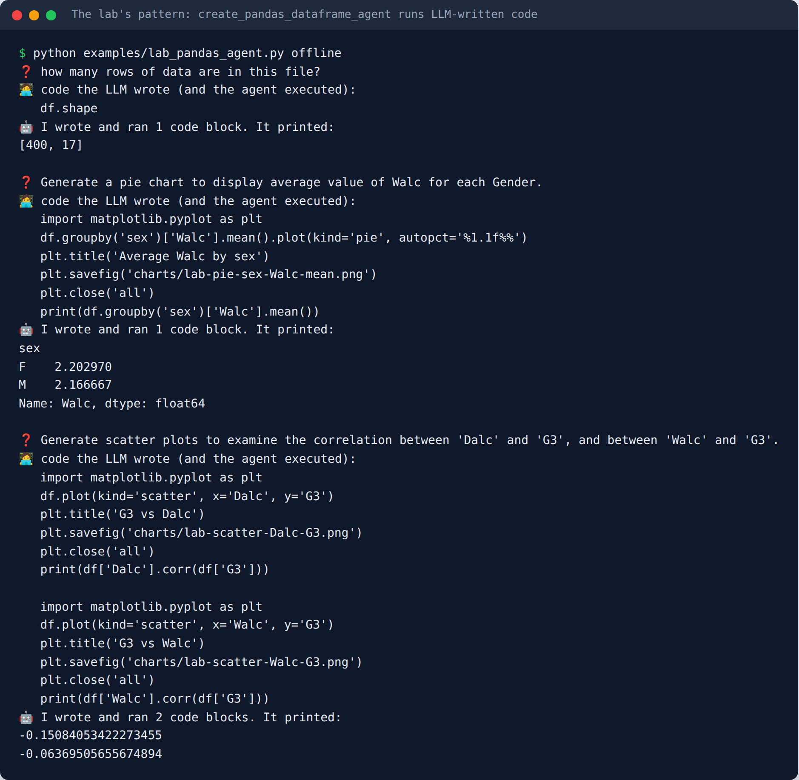
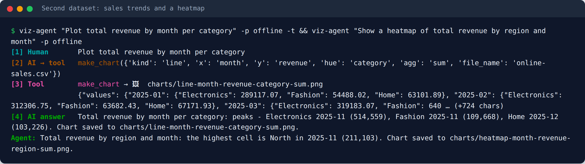
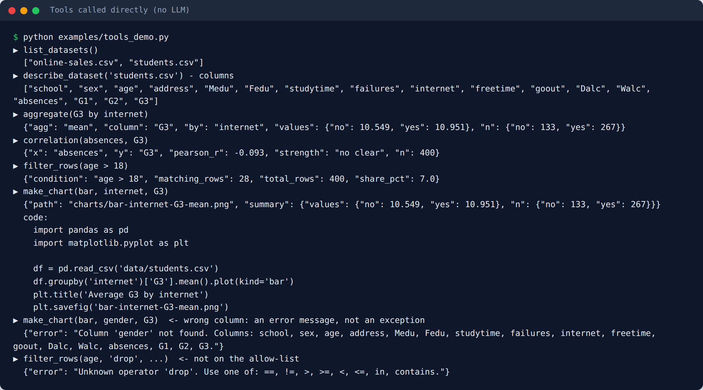
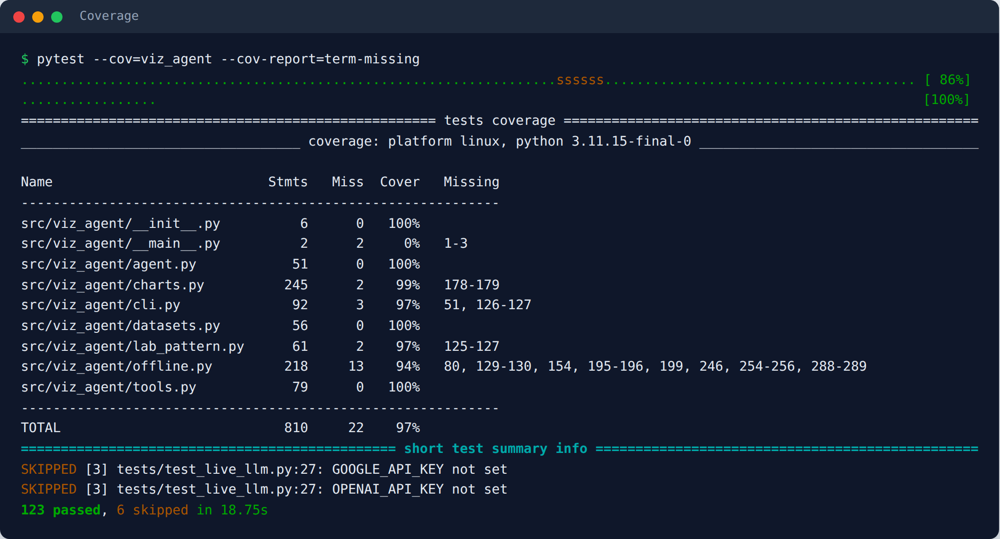
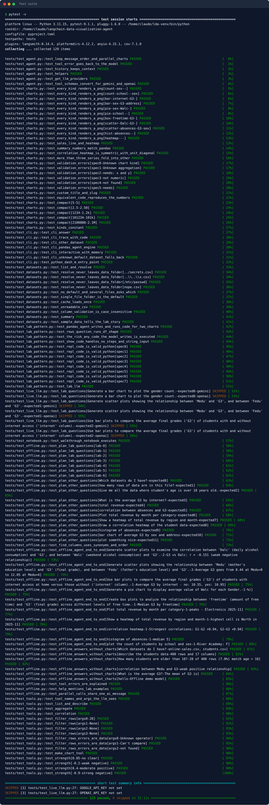

# Data Visualization Agent: Chat with Your CSV and Get Charts (LangChain)

[](https://github.com/<your-user>/langchain-data-visualization-agent/actions/workflows/tests.yml)


Ask for a chart in plain English, for example *"Generate scatter plots of Dalc vs G3 and Walc vs G3"* or *"Plot total revenue by month per category"*. An AI agent picks the right chart and columns, draws the chart with pandas and matplotlib, and explains what the numbers show. It's built with LangChain 1.x `@tool` and `create_agent`. It works with **Google Gemini** (free API tier), **OpenAI**, or a built-in **offline mode** that needs no key and costs nothing.

The agent never writes or runs code. The LLM only fills in **typed tool arguments** (chart kind and column names), and Python checks them against the data before drawing anything. Each chart still comes back with its equivalent pandas code, so you can see and reuse what was done.

> Portfolio version of the lab *"Use Natural Language to Create Charts and Graphs"* from IBM's **Fundamentals of Building AI Agents** course (Coursera), re-implemented as a tested, installable package. See [Credits](#credits).



---

## Contents

- [Changes from the original lab](#changes-from-the-original-lab)
- [What the lab asks you to do](#what-the-lab-asks-you-to-do)
- [Chart gallery](#chart-gallery)
- [Features](#features)
- [Quick start (free)](#quick-start-free)
- [How it works](#how-it-works)
- [Usage](#usage): CLI · Python API · notebook
- [Testing](#testing)
- [Project structure](#project-structure)
- [Configuration](#configuration)
- [Lessons learned](#lessons-learned)
- [Credits](#credits)

## Changes from the original lab

* **Newer LangChain:** it uses LangChain 1.x `create_agent` with typed tools. The lab's original `create_pandas_dataframe_agent` is still included as a runnable example with its own screenshot, so you can compare the two.
* **Gemini by default:** it uses a free Gemini API key, and OpenAI and offline mode are also built in. The lab used Llama 4 on IBM watsonx.ai.
* **Own data:** it ships its own made-up datasets, a students one (same columns as the lab's `student-mat.csv`) and an online-sales one, instead of IBM's.
* **Fixes:**
  * The original agent **ran any Python the LLM wrote**. Here the LLM can only call six read-only tools, and every column, operator and chart kind is checked against an allow-list.
  * The lab's broken import (`ibm_watson_machine_learning`, a retired package) is gone.
  * `intermediate_steps[-1]` no longer crashes when there are no steps.
  * `handle_parsing_errors` is now actually applied. Newer versions ignore it when it's passed the lab's way.

## What the lab asks you to do

**The goal:** a "conversational data agent" that answers questions about a CSV file and turns the answers into charts, so you can ask *"compare X and Y"* instead of writing matplotlib code.

| Lab step | What you do | Where it lives here |
|---|---|---|
| 1. Load data | read the students CSV into a DataFrame | [`datasets.py`](src/viz_agent/datasets.py) (`DatasetStore`, cached, path-safe) |
| 2. LLM | connect Llama 4 on watsonx.ai | `get_llm()` in [`agent.py`](src/viz_agent/agent.py): Gemini · OpenAI · offline |
| 3. Agent | `create_pandas_dataframe_agent(llm, df, ...)` | typed tools + `create_agent`; the original in [`lab_pattern.py`](src/viz_agent/lab_pattern.py) |
| 4. Ask questions | row count, filtering (*age > 18*) | `describe_dataset`, `filter_rows` tools |
| 5. Charts | gender count (bar), Walc per gender (pie), freetime vs G3 (box), Dalc/Walc vs G3 (scatter) | `make_chart` in [`tools.py`](src/viz_agent/tools.py), engine in [`charts.py`](src/viz_agent/charts.py) |
| 6. Read the code | print the code the LLM wrote, from `intermediate_steps` | every chart returns its equivalent code (`--code`) |
| Exercise 1 | Medu / Fedu vs G3 scatter plots | [`examples/lab_exercises.py`](examples/lab_exercises.py) |
| Exercise 2 | internet access vs average G3 (bar) | same |
| Exercise 3 | absences vs G3 scatter, **plus the code behind it** | same |

The lab's scatter-plot task asks for **two** charts in one question. The model answers with two **parallel tool calls** in a single message:



Exercises 1 and 2, each checked against plain pandas:



Exercise 3 wants to see the code. In the lab, that code was what the LLM generated and the agent executed. Here, it's what the tool *would* write, and it's returned for you to read:



### The lab's pattern, kept for comparison

`create_pandas_dataframe_agent` gives the LLM a Python REPL with `df` loaded and **executes the code it writes**, which is why LangChain makes you pass `allow_dangerous_code=True`. It runs here with an offline stand-in that writes pandas code the way the lab's Llama model did:



## Chart gallery

Every chart below was drawn by the `make_chart` tool, with the exact output the agent produces.

| | |
|---|---|
|  |  |
| **Task 1:** *"Generate a bar chart to plot the gender count."* | **Task 2:** *"…pie chart to display average value of Walc for each Gender."* |
|  |  |
| **Task 3:** box plots, freetime vs G3 | **Task 4:** Dalc vs G3 (jittered, with the mean per level) |
|  |  |
| **Exercise 1:** mother's education vs final grade (r = 0.29) | **Exercise 2:** internet at home vs average grade |
|  |  |
| **Exercise 3:** absences vs G3 (r = −0.09, no clear link) | *"Draw a correlation heatmap"*, diverging scale centered on 0 |
|  |  |
| *"Plot total revenue by month per category"* | *"Heatmap of total revenue by region and month"* |

The chart styling uses a colorblind-checked palette, one hue per series in a fixed order, at most 3 colored series (the rest fold into "Other"), a single-hue scale for magnitudes, a two-hue scale with a gray midpoint for correlations, light grid lines, and no dual axes.



## Features

| | |
|---|---|
| 📊 **8 chart kinds** | count, bar, pie, box, scatter, histogram, line, heatmap (pivot or correlation), each with optional grouping (`hue`) and aggregation |
| 🧰 **6 typed tools** | `list_datasets`, `describe_dataset`, `aggregate`, `correlation`, `filter_rows`, `make_chart` |
| 🔒 **No code execution** | the LLM fills in arguments, and columns, operators and kinds are validated; files are restricted to the data folder |
| 🔢 **Numbers with every chart** | each chart returns the values it shows (means, counts, Pearson r…), so the answer is grounded and testable |
| 🧾 **Equivalent code** | each chart also returns the plain pandas/matplotlib snippet (the lab's "read the code" lesson, without running LLM code) |
| ⚠️ **Errors as data** | *"Column 'gender' not found. Columns: school, sex, …"* goes back to the model, which corrects itself |
| 🔌 **3 providers** | `gemini` (free tier) · `openai` · `offline` (no key, no cost) |
| 🧪 **Lab pattern included** | `--engine pandas-agent` runs the original `create_pandas_dataframe_agent` |
| 💬 **CLI chat** | `viz-agent`, with `--trace` to watch each tool call and `--code` for the snippets; remembers the conversation |
| ✅ **123 tests, 97% coverage** | all offline in CI; live LLM evaluation is opt-in |

## Quick start (free)

```bash
git clone https://github.com/<your-user>/langchain-data-visualization-agent.git
cd langchain-data-visualization-agent
python -m venv .venv && source .venv/bin/activate        # Windows: .venv\Scripts\activate
pip install -e ".[gemini,dev]"

# 1) No key, no cost - offline mode
viz-agent "Generate scatter plots of 'Dalc' vs 'G3' and 'Walc' vs 'G3'" -p offline --trace
#    -> charts/scatter-Dalc-G3.png, charts/scatter-Walc-G3.png

# 2) Real LLM, still free: get a key at https://aistudio.google.com -> "Get API key"
cp .env.example .env          # paste GOOGLE_API_KEY=... (Windows: copy .env.example .env)
viz-agent                     # interactive chat, type 'exit' to quit
```

> **Cost:** offline mode and the tests never call an API. Gemini's free tier has rate limits (a busy question can hit a 429; just retry), and Google may use free-tier prompts to improve its models, so keep private data out. OpenAI is billed per token. The model sees column names, summaries and at most a few preview rows, never the whole file.

## How it works

### 1. A chart is a typed tool call

The tool's docstring tells the LLM which kinds exist and which columns each one needs. The model's whole job is to fill in the arguments:

```python
@tool
def make_chart(kind: str, x: str = "", y: str = "", hue: str = "", agg: str = "mean",
               title: str = "", file_name: str = "") -> dict[str, Any]:
    """Draw a chart and save it as a PNG. Returns the file path, the numbers shown and the equivalent pandas code.

    Kinds and the columns they need:
      count   - x (categorical); optional hue: rows per category ("plot the gender count")
      scatter - x + y (both numeric): relationship / correlation
      ...
    """
    try:
        return render(ChartSpec(kind, x, y, hue, agg, title), file_name).as_dict()
    except DatasetError as exc:
        return {"error": str(exc)}
```

`render()` validates the spec (known kind and aggregation, existing columns, numeric where needed), draws the chart, and returns:

```python
{"path": "charts/scatter-Dalc-G3.png", "kind": "scatter", "title": "G3 vs Dalc",
 "summary": {"pearson_r": -0.151, "n": 400, "mean_by_x": {"1": 11.08, "2": 10.613, ...}},
 "code": "import pandas as pd\n...df.plot(kind='scatter', x='Dalc', y='G3')\n..."}
```

All the tools can be called directly, with no LLM:



### 2. The agent loop

```python
from viz_agent import build_agent, get_llm, ask, final_answer, charts

agent = build_agent(get_llm("gemini"))       # or "openai" / "offline"
response = ask(agent, "Use bar plots to compare the average G3 of students with and without internet access")
print(final_answer(response))                # "Students with internet average 10.95 vs 10.55 without..."
print(charts(response))                      # ['charts/bar-internet-G3-mean.png']
```

`create_agent` repeats **model → tools → model** until the model stops calling tools:

| Message | Meaning |
|---|---|
| `Human` | the question |
| `AI → tool` / `AI → 2 tools` | the model chose tools and arguments (`AIMessage.tool_calls`); several = parallel calls |
| `Tool` | the real result (`ToolMessage`): chart path + numbers, or an error to correct |
| `AI answer` | no more tool calls, so it writes the final plain-language answer |

### 3. Typed tools vs. the lab's code-executing agent

| | Lab: `create_pandas_dataframe_agent` | This repo: typed tools |
|---|---|---|
| What the LLM produces | Python code | tool arguments (`kind`, `x`, `y`…) |
| What runs | that code, in a REPL (`allow_dangerous_code=True`) | fixed, tested Python |
| Wrong column name | `KeyError` traceback, maybe a retry | `{"error": "Column 'gender' not found. Columns: …"}` |
| Reproducible output | depends on the code the model writes | same spec → same chart and numbers |
| Seeing the code | `intermediate_steps[-1][0].tool_input` | `result["code"]` / `--code` |
| Testable | hard | each tool, the engine and the agent's decisions |

## Usage

### CLI

```bash
viz-agent "Plot the gender count"
viz-agent "Generate a pie chart to display average value of Walc for each Gender." --trace
viz-agent "Plot a scatter plot of absences vs G3" -t --code          # show the pandas code
viz-agent "Plot total revenue by month per category" -d online-sales.csv
viz-agent "How many students are older than 18?"                      # answers without a chart
viz-agent "pie chart of average Walc for each gender" -e pandas-agent -t   # the lab's original agent
viz-agent --data-dir path/to/my/csvs -d my.csv -p gemini              # your own data
python -m viz_agent --help
```

Charts are written to `charts/` (or `$CHART_DIR`).

### Python API

```python
from viz_agent import configure, build_agent, get_llm, ask, tool_calls, make_chart

configure("data", "students.csv")
agent = build_agent(get_llm("offline"))
response = ask(agent, "Generate scatter plots showing the relationship between 'Medu' and 'G3', and between 'Fedu' and 'G3'.")
[(c["args"]["x"], c["result"]["summary"]["pearson_r"]) for c in tool_calls(response)]
# [('Medu', 0.288), ('Fedu', 0.247)]

followup = ask(agent, "Which one is stronger?", history=response["messages"])   # keeps context

make_chart.invoke({"kind": "box", "x": "freetime", "y": "G3"})               # a tool on its own
```

The examples in [`examples/`](examples/) cover the lab tasks (`quickstart.py`), the three exercises with pandas checks (`lab_exercises.py`), the tools with no LLM (`tools_demo.py`), and the lab's original agent (`lab_pandas_agent.py`).

### Notebook

[`notebooks/walkthrough.ipynb`](notebooks/walkthrough.ipynb) goes from tools, to a direct chart, to the lab's four tasks, to Exercises 1–3, to the sales data, to evaluating the agent. The charts are embedded in the notebook, so it renders on GitHub. It runs offline by default.

<details>
<summary>Screenshot of the executed notebook</summary>


</details>

### Sample data

`data/` contains two **synthetic** datasets, generated by `scripts/make_datasets.py` (seed 7):

| File | Rows | Columns | Built-in patterns |
|---|---|---|---|
| `students.csv` | 400 | school, sex, age, address, Medu, Fedu, studytime, failures, internet, freetime, goout, Dalc, Walc, absences, G1, G2, G3 | grades rise with parents' education; slightly higher with internet; weakly lower with alcohol and absences |
| `online-sales.csv` | 144 | month (2025-01…12), category, region, orders, revenue | Electronics dominates; November/December peak |

To use the lab's original file instead: `python examples/download_lab_dataset.py`, then `viz-agent "Plot the gender count" --data-dir data/lab -d student-mat.csv`.

## Testing

```bash
pytest                                            # 123 offline tests, no API keys
pytest --cov=viz_agent --cov-report=term-missing
pytest -m live -v                                 # real-LLM evaluation (GOOGLE_API_KEY / OPENAI_API_KEY)
```

| Test file | What it checks | LLM? |
|---|---|---|
| `test_datasets.py` | discovery, path safety (`../secrets.csv`), cache, column validation, the sample data's patterns | no |
| `test_charts.py` | every chart kind renders; numbers match pandas; validation errors; "Other" folding; the returned code runs and reproduces the result | no |
| `test_tools.py` | tool names/schemas the LLM sees; aggregate, correlation, filter allow-list; errors returned, not raised | no |
| `test_offline.py` | the lab's questions and exercises → the right charts and columns; parallel calls; full `create_agent` loop | no |
| `test_agent.py` | `create_agent` with a scripted fake model: message order, self-correction after an error, history; providers; Gemini/OpenAI schema conversion | no |
| `test_lab_pattern.py` | the lab's `create_pandas_dataframe_agent`, `show_code`, and a test that shows the agent executes whatever code it's given | no |
| `test_cli.py` | answers, `--trace`, `--code`, `--engine pandas-agent`, interactive chat with memory, `python -m` | no |
| `test_notebook.py` | the walkthrough notebook runs top to bottom | no |
| `test_live_llm.py` | a real model picks the **right chart kind and columns** for the lab questions, and the PNG exists | yes |

**Strategy:** everything that can be deterministic (data, chart engine, tools, orchestration) is tested offline in CI. Real-model behavior is a separate, opt-in **evaluation** that checks *which chart was made from which columns*, never the wording.



<details>
<summary>Full test list (pytest -v)</summary>



</details>

CI runs the offline suite on Python 3.10–3.12. The live job runs on push only, for providers whose key is stored as a repository secret.

## Project structure

```
langchain-data-visualization-agent/
├── src/viz_agent/
│   ├── datasets.py      # DatasetStore: discovery, cache, path safety, column validation
│   ├── charts.py        # ChartSpec -> validated matplotlib chart + numbers + equivalent code
│   ├── tools.py         # the 6 @tool wrappers the LLM calls
│   ├── agent.py         # get_llm() provider switch, build_agent(), response helpers
│   ├── offline.py       # rule-based stand-in model (no key, no cost)
│   ├── lab_pattern.py   # the lab's create_pandas_dataframe_agent + an offline code-writing model
│   └── cli.py           # `viz-agent` chat with --trace / --code / --engine
├── data/                # synthetic students.csv and online-sales.csv
├── tests/               # 123 offline tests + opt-in live evals
├── examples/            # quickstart, lab exercises, tools demo, lab pandas agent, lab-data download
├── notebooks/           # walkthrough.ipynb (executed, charts embedded)
├── scripts/             # make_datasets.py, build_notebook.py, make_screenshots.py
├── docs/images/         # README screenshots + chart gallery
└── .github/workflows/   # CI
```

## Configuration

Copy `.env.example` to `.env`:

| Variable | Default | Purpose |
|---|---|---|
| `LLM_PROVIDER` | `gemini` | `gemini` · `openai` · `offline` |
| `GOOGLE_API_KEY` / `GEMINI_MODEL` | – / `gemini-2.5-flash` | Gemini (free key from AI Studio) |
| `OPENAI_API_KEY` / `OPENAI_MODEL` | – / `gpt-4o-mini` | OpenAI |
| `DATA_DIR` / `DEFAULT_DATASET` | `data` / `students.csv` | where the CSVs are and which one is the default |
| `CHART_DIR` | `charts` | where PNGs are written |

Extras: `pip install -e ".[gemini]"`, `".[openai]"`, `".[lab]"` (the lab's pandas agent: `langchain-experimental`), `".[dev]"`, or `".[all]"`.

### About offline mode

`OfflineVizModel` is **not an LLM**. It's a small keyword-rule model that uses the same tool-calling protocol (emits `tool_calls`, reads `ToolMessage`s), so the real agent loop, tools and charts run without a key. It recognizes column names and a few synonyms (*gender → sex*, *final grade → G3*, *weekend alcohol → Walc*), picks the chart kind from words like *pie*, *box*, *scatter*, *heatmap* or *monthly*, and writes its answer from the numbers the tools return. It's useful for demos, CI and screenshots. For open-ended questions, use Gemini or OpenAI.

All screenshots are real output of the commands shown, generated in offline mode by `python scripts/make_screenshots.py`.

## Lessons learned

- **Don't let the LLM run code when typed tools will do.** `create_pandas_dataframe_agent` is convenient, but it runs anything the model writes on your machine. A small set of typed, validated tools covers the lab's charts and questions with no code execution.
- **Return numbers, not just pictures.** The model can't see the PNG. Returning the plotted values (means, counts, r) lets it explain the chart truthfully, and lets tests check it.
- **Error messages are prompts.** *"Column 'gender' not found. Columns: school, sex, …"* is enough for the model to retry with `sex`.
- **One question, several tool calls.** "Dalc vs G3 *and* Walc vs G3" gives two parallel `make_chart` calls in one AI message.
- **Correlation isn't a strong effect.** Absences vs G3 gives r = −0.09: the chart looks like a cloud, and the agent says *no clear relationship* instead of overclaiming.
- **Fix the lab's sharp edges:**
  * `intermediate_steps[-1]` fails when the agent answers without a step.
  * `handle_parsing_errors=True` passed directly is now ignored, with a warning.
  * The import from the retired `ibm_watson_machine_learning` package fails on a fresh install.
  * `MAX_NEW_TOKENS: 256` cuts off longer code.
  * `verify=False` disables TLS checks.
  * `langchain-experimental` is being sunset.
- **Pick chart colors on purpose.** One hue per series in a fixed order, a single-hue scale for magnitudes, a two-hue scale centered on zero for correlations, and no more than 3 colored series.

## Credits

- Concept and exercises: IBM Skills Network lab *Use Natural Language to Create Charts and Graphs* (authors Kang Wang and Wojciech Fulmyk; contributor Ricky Shi), part of **Fundamentals of Building AI Agents** on Coursera. The original notebook is IBM-copyrighted and is **not** included. This repo is an independent re-implementation with its own synthetic data.
- Built with [LangChain](https://python.langchain.com/), [LangGraph](https://langchain-ai.github.io/langgraph/), [pandas](https://pandas.pydata.org/) and [matplotlib](https://matplotlib.org/).

## License

[MIT](LICENSE) © VictorV
